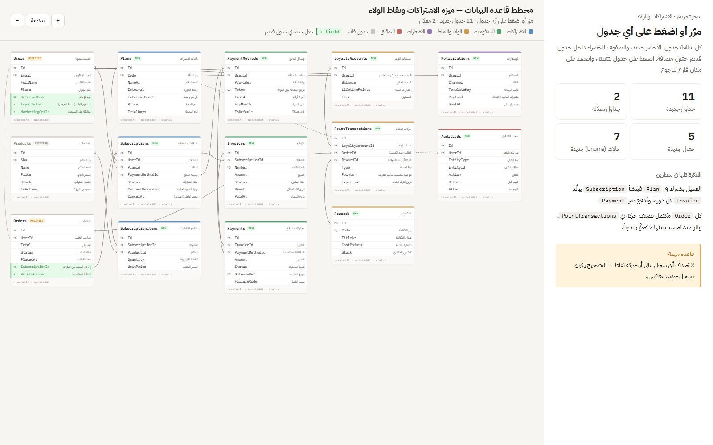

# ERD Explorer Template · مستكشف مخطط قاعدة البيانات

<div dir="rtl">

قالب صفحة HTML واحدة لعرض مخطط قاعدة بيانات (ERD) بشكل تفاعلي وبالعربي. الصفحة ما تحتاج أي مكتبة، كلها JavaScript عادي، والـ CSS والـ JS داخل الملف نفسه.

مفيد لما تبي تشرح لفريقك **وش الجداول الجديدة، ووش اللي تغيّر في الجداول القديمة، وكيف يرتبطون ببعض**، بدل ما تعطيهم صورة ثابتة أو ملف SQL.

</div>



<div dir="rtl">

## المميزات

- **واجهة عربية (RTL)**، وأسماء الجداول والحقول تبقى بالإنجليزي وبخط Mono.
- **تمييز التغييرات:** كل جدول عليه وسم `NEW` أو `MODIFIED` أو `EXISTING`، والحقول الجديدة داخل الجداول القديمة تظهر بخلفية خضراء.
- **خطوط العلاقات:** منحنيات Bézier تبدأ من صف الـ FK في الجدول الابن وتنتهي عند صف الـ PK في الجدول الأب، ويمكن رسمها متقطعة.
- **وضع التركيز:** لما تمرّر على جدول تبهت باقي الجداول، ويبقى الجدول وعلاقاته واضحين.
- **التثبيت:** الضغط على جدول يثبّته، والضغط مرة ثانية أو على مكان فارغ أو زر ✕ (أو مفتاح Esc) يلغي التثبيت.
- **شريط جانبي:** يعرض ملخص الجدول ومثال واقعي، والحقول المهمة والحالات (Enums) والعلاقات القابلة للضغط، وقاعدة مهمة.
- **تكبير وتصغير:** من 0.35 إلى 1.6، وزر «ملاءمة» يضبط الحجم على عرض الشاشة.
- **دعم الجوال:** الشريط الجانبي يتحول لـ bottom sheet يطلع من تحت.

## الشكل المبدئي

</div>

```
┌──────────────────────────────────────────────────────────┬──────────────────────┐
│ [−][ملاءمة][+]          عنوان المشروع                    │  اسم المشروع          │
│               مرّر أو اضغط على أي جدول · 11 جديد · 2 معدّل │  مرّر أو اضغط على    │
│        ■ مجموعة ■ مجموعة ■ مجموعة  [+ field] حقل جديد    │  أي جدول              │
├──────────────────────────────────────────────────────────┤                      │
│  col 0          col 1          col 2          col 3      │  ┌────────┬────────┐  │
│ ┌──────────┐   ┌──────────┐   ┌──────────┐   ┌────────┐  │  │ 11     │ 2      │  │
│ │▀▀▀▀▀▀▀▀▀▀│   │▀▀▀▀▀▀▀▀▀▀│   │▀▀▀▀▀▀▀▀▀▀│   │▀▀▀▀▀▀▀▀│  │  │ جديدة  │ معدّلة │  │
│ │Users MOD │   │Plans NEW │   │Invoices  │   │  ...   │  │  ├────────┼────────┤  │
│ │PK Id     │◄──┤PK Id     │   │PK Id     │   │        │  │  │ 5 حقول │ 7 حالات│  │
│ │   Email  │   │   Code   │   │FK SubId ●┼──►│        │  │  └────────┴────────┘  │
│ │+  Referr…│   └──────────┘   └──────────┘   └────────┘  │                      │
│ └──────────┘        ▲                                    │  الفكرة كلها في سطرين │
│ ┌──────────┐   ┌────┴─────┐                              │  ...                  │
│ │Products  │   │Subscript…│                              │  ┌ قاعدة مهمة ──────┐ │
│ │ EXISTING │   │FK UserId●│                              │  │ ...              │ │
│ └──────────┘   └──────────┘                              │  └──────────────────┘ │
└──────────────────────────────────────────────────────────┴──────────────────────┘
          canvas (قابل للتمرير والتكبير)                       sidebar 380px
```

<div dir="rtl">

## الاستخدام

1. افتح [`index.html`](index.html) في المتصفح. فيه مخطط تجريبي لمتجر إلكتروني يضيف ميزة الاشتراكات ونقاط الولاء.
2. لعرض مخططك أنت، عدّل الكائنات الموجودة في قسم `DATA` أعلى السكربت فقط، والباقي ما يحتاج تعديل.

### نموذج البيانات

</div>

```js
// المجموعات وألوانها
const G = {
  sub: { c: 'oklch(0.64 0.11 250)', ar: 'الاشتراكات' },
  old: { c: '#c9c5bd',              ar: 'جدول قائم' }
};

// f(name, type, key = '', note = '', isNew = false)
const T = {
  Subscriptions: {
    col: 1, group: 'sub', isNew: true, mod: false, ar: 'اشتراكات العملاء',
    fields: [ f('Id','bigint','PK'), f('UserId','bigint','FK','المشترك') ],
    tldr: 'سطر واحد يشرح الجدول',
    ex: 'مثال واقعي — يدعم `code` بين علامتي backtick',
    keys:    [['Status', 'شرح الحقل']],
    newKeys: [['NewField', 'شرح الحقل الجديد']],   // للجداول المعدّلة
    enumName: 'SubscriptionStatus',
    enums: [['Active', 'نشط'], ['Canceled', 'ملغى']], // القيمة = الترتيب، أو ['Key','label',value]
    rule: 'قاعدة مهمة'
  }
};

// [الابن, حقل FK, الأب, نوع العلاقة, متقطع؟]
const R = [ ['Subscriptions', 'UserId', 'Users', '1:N', false] ];

// نصوص الحالة الفارغة (اختيارية الإحصائيات — تُحسب تلقائياً لو null)
const META = { project, title, hint, idea: [...], rule, stats: null };
```

<div dir="rtl">

> كل النصوص تمر على escape قبل ما تُضاف للـ HTML، والنص اللي بين علامتي backtick يظهر كـ code chip.

## توليد الصفحة بالذكاء الاصطناعي

البرومبت الكامل اللي بُني منه القالب موجود في [`PROMPT.md`](PROMPT.md). انسخه، وعبّئ قسم **INPUT** بمخططك، وأعطه لأي نموذج لغوي، وراح يطلع لك صفحة بنفس الشكل.

## هيكل المستودع

</div>

```
.
├── index.html        # القالب + مخطط تجريبي
├── PROMPT.md         # البرومبت الكامل
└── docs/preview.png  # صورة المعاينة
```
